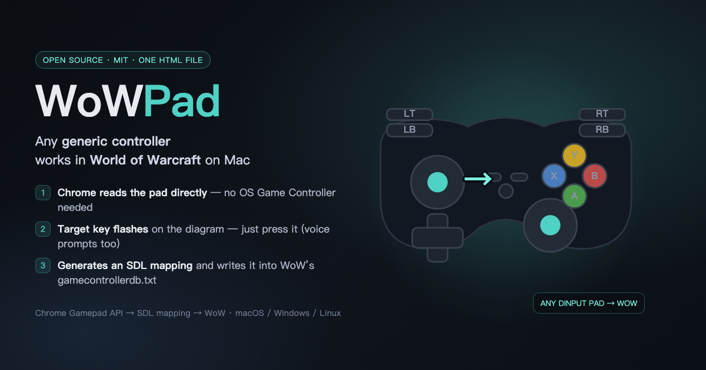
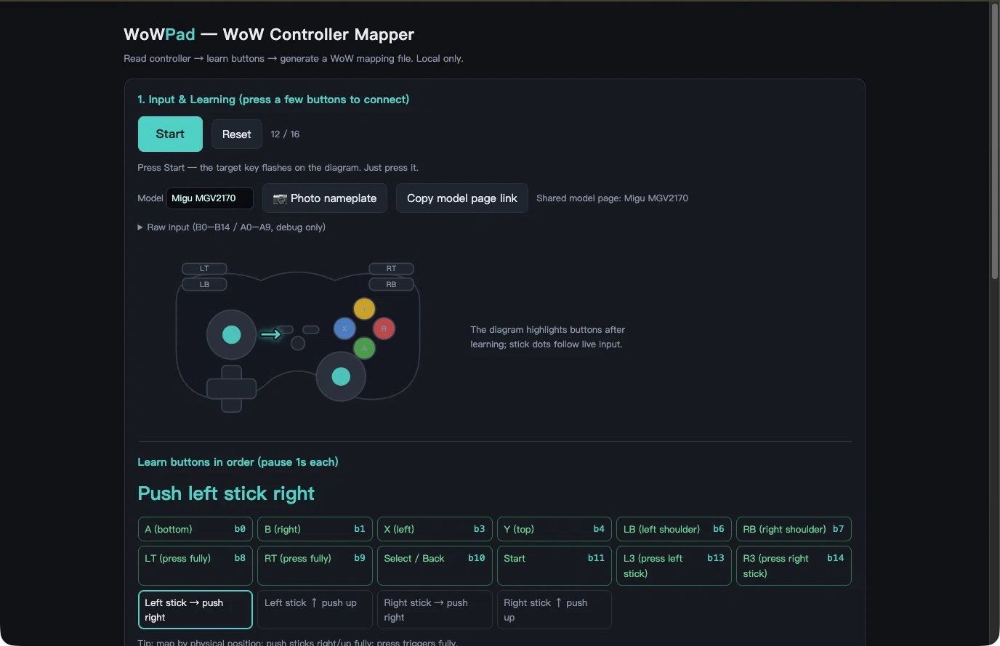
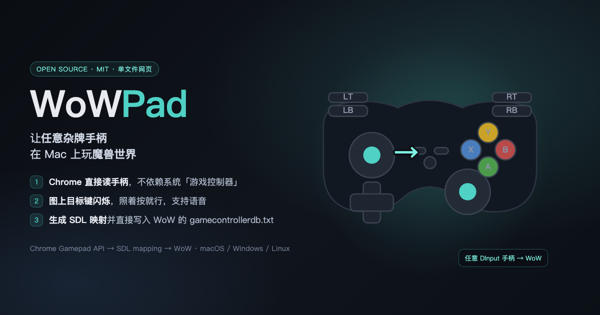

# WoWPad — any controller in World of Warcraft on macOS

**Single-file web tool.** Read a generic DInput controller in Chrome, learn its buttons, generate an SDL mapping, and write it straight into WoW's `WTF/gamecontrollerdb.txt`.

No driver, no install, no backend, no database.



## Why

On macOS, generic DInput pads (Migu, Beitong, Flydigi, no-name Chinese pads…) show up as plain HID devices. Apple's GameController framework ignores them, so macOS games don't see a gamepad — but **Chrome's Gamepad API does** read them, and **WoW bundles SDL2**, which only needs a mapping line.

WoWPad does the missing last mile:

1. read the pad in Chrome (Gamepad API)
2. guide you to press every button — the target key **flashes on the diagram** (voice prompts too)
3. generate the SDL mapping string
4. write it into `_retail_/WTF/gamecontrollerdb.txt` (file picker or drag & drop, automatic backup)

## Screenshots

| UI (EN) | UI (ZH) |
|---|---|
|  |  |

| Card (EN) | Card (ZH) |
|---|---|
|  |  |

## Quick start

1. Connect the pad in **DInput / 2.4G mode** (not the BLE keyboard mode).
2. Open `index.html` in Chrome or Edge (or the hosted page, if available).
3. Click **Start**, press the keys as prompted (pause ~1s each).
4. **Generate**, then **Write to WoW file…** (or drop `gamecontrollerdb.txt` into the dashed box).
5. Fully restart WoW → `/console GamePadEnable 1` → bind under **Keybindings → Gamepad**.

## Features

- Live input + **target key flashing** on an Xbox/PlayStation/Switch skin
- Short voice prompts (Web Speech, local), language follows the browser (zh/en)
- Generates SDL mapping; GUID from VID/PID with zero CRC (verified to match on macOS)
- Writes directly into WoW's `gamecontrollerdb.txt` (File System Access API, with backup) or drag & drop the file/folder
- Community lookup by VID/PID in [SDL_GameControllerDB](https://github.com/mdqinc/SDL_GameControllerDB)
- "New species" submission: copy JSON / prefilled GitHub issue
- AI diagnostics package (copy JSON, paste into any AI)
- Raw input hidden behind a debug section; single HTML file; MIT

## How the mapping works

```
03000000618f000031f8000000000000,MIGU MGV2170,platform:Mac OS X,a:b0,b:b1,...
```

- GUID layout: bus `0300` + zero CRC + vendor LE + 0 + product LE + 0 + version + 0
- SDL on macOS matches even with zeroed CRC (tested with SDL 2.32)
- For DInput pads, stick axes are canonical `a0..a3`; hats are `h0.1/2/4/8`

## Tested

- Migu MGV2170 (VID `0x8F61` / PID `0xF831`, 2.4G DInput dongle)
- macOS 26.5.2 (M4), World of Warcraft 1.60.1 (CN beta)
- ConsolePort 3.3.10 is blocked by the client's addon restrictions for now — native gamepad bindings work

## Limitations

- BLE keyboard-style mode is invisible to SDL/WoW — use DInput/2.4G/wired
- macOS GameController framework still ignores these pads (that's why this tool exists)
- Mobile browsers vary in Gamepad API support; learning is best on desktop

## License

MIT
